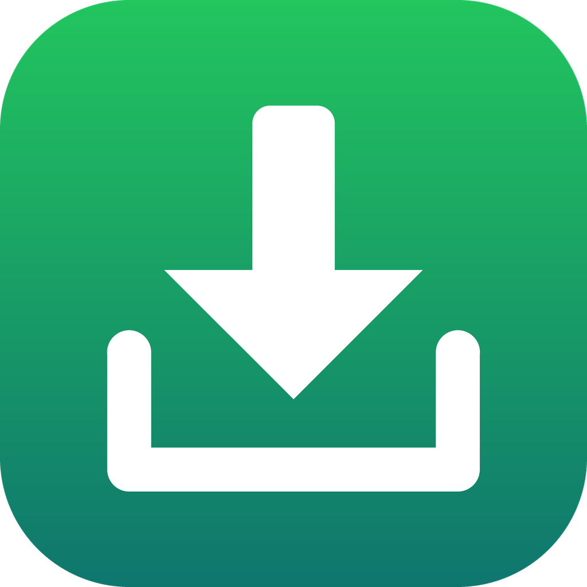
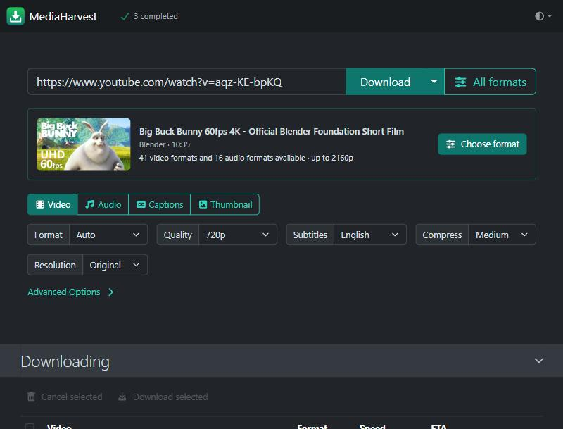
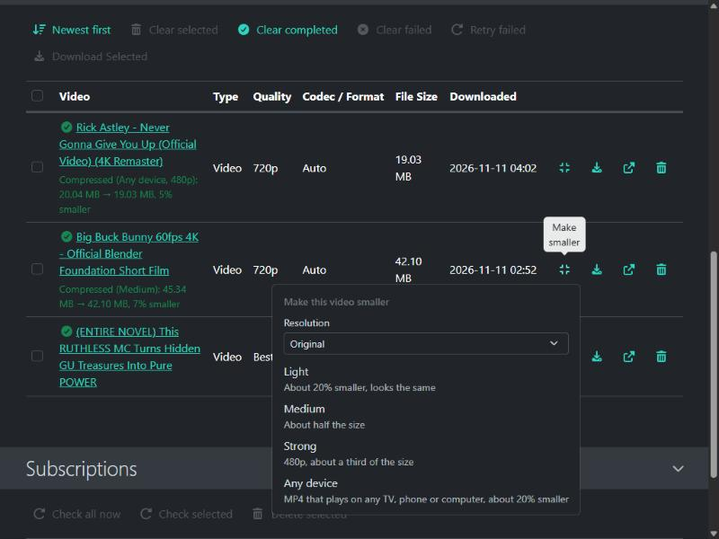
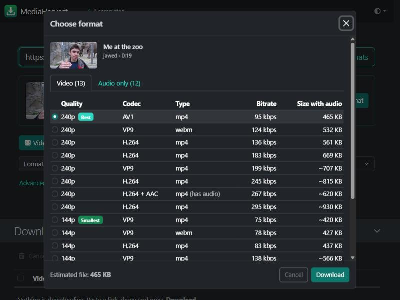
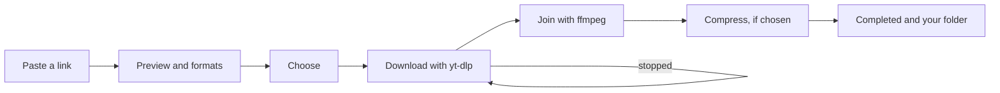

<p align="center">
  
</p>

<h1 align="center">MediaHarvest</h1>

<p align="center">
  Paste a link, see every format the video offers, and save the video or music
  in the quality and size you choose. It runs on your own computer, in Docker.
</p>



## What it does

**Any link, every option.** Paste a link and MediaHarvest shows what it is and how
many formats it has. **All formats** lists every stream: resolution, frame rate,
HDR, codec, bitrate and file size, with the best and the smallest marked. Or just
press **Download** with your usual settings. YouTube and
[more than a thousand other sites](https://github.com/yt-dlp/yt-dlp/blob/master/supportedsites.md)
work, through [yt-dlp](https://github.com/yt-dlp/yt-dlp).

**Music that sounds right and stays small.**
- *Original* keeps the audio exactly as the site serves it: the best quality and
  usually the smallest file.
- Need it smaller? Opus 128/96/64 kbps, M4A 192/128/96 kbps or MP3 320/192/128 kbps
  really re-encode to that size. A source already below the size you pick is kept as is.
- The thumbnail is embedded as cover art, with title and artist tags.
- Optional lyrics from [LRCLIB](https://lrclib.net), written into the file, plus a
  timed `.lrc` file when available.

**Video, including very long ones.**
- Subtitles: English by default (written ones, or YouTube's automatic ones when
  there are none), English plus other languages, or none. They're embedded as
  switchable tracks and saved beside the video as `.srt`.
- No length or size limit. A download that stops (the network drops, or YouTube's
  video link expires, which it does after about 6 hours) carries on by itself from
  where it stopped, with a fresh link. So does one cut off by a restart. Each
  failed try waits longer, from 15 seconds up to 5 minutes; after 10 tries in a
  row with no progress it shows as failed, and **Retry** still continues from
  the partial file.
- Disk space is checked before a download starts, counting the room needed to
  merge video and audio (about twice the final size).

**Smaller videos, if you want them.** Pick a **Compress** level and the video is
re-encoded after it downloads, on your own computer, with open-source tools
(ffmpeg). You can also compress a finished video later from **Completed**.
Tested on a 138-hour YouTube video (51.3 GB at 720p):

| Level | Size | How it looks | Plays on |
|---|---|---|---|
| Light | 24% smaller | the same to the eye | current phones, computers, browsers |
| Medium | 51% smaller | very close; fine detail a little softer | current phones, computers, browsers |
| Strong | 64% smaller | 480p, for talks and audiobooks | current phones, computers, browsers |
| Any device | about 20% smaller | close to the original | every TV, phone and computer (MP4) |

Add a **Resolution** limit (1080p down to 360p) to make it smaller still.
Subtitle tracks, every sound track and chapters are kept. Any device uses an
NVIDIA graphics card when there is one. The other levels take about 4 minutes
per hour of video on a 12-core computer. If a video wouldn't get at least 5%
smaller, the original is kept. Details:
[Making videos smaller](docs/FEATURES.md#making-videos-smaller-compress).

**And more:** whole playlists and channels, subscriptions that fetch new uploads,
clips by start and end time, sponsor-segment removal, splitting by chapters,
captions or thumbnails on their own.





## Guides

| Guide | For |
|---|---|
| [Features](docs/FEATURES.md) | Every option on the page, explained simply, with which to pick |
| [How it works](docs/HOW-IT-WORKS.md) | What happens from link to file, how compression works, and which code does what |
| [Configuration](docs/CONFIGURATION.md) | Settings for whoever runs it: folders, file names, ports, the graphics card |

## Install

You need [Docker](https://docs.docker.com/get-docker/) (on Windows and Mac:
Docker Desktop, started). MediaHarvest then opens at **http://localhost:8081**.

**Windows** (PowerShell):

```powershell
irm https://raw.githubusercontent.com/MohanVishe/mediaharvest/main/install.ps1 | iex
```

**Linux, macOS, WSL:**

```bash
curl -fsSL https://raw.githubusercontent.com/MohanVishe/mediaharvest/main/install.sh | sh
```

The installer makes one folder (`MediaHarvest` in your user folder) with the
settings, starts MediaHarvest and saves files to `Downloads/MediaHarvest`. Run it
again any time to update. You can read both scripts before running them:
[install.ps1](install.ps1), [install.sh](install.sh).

**Docker Compose**, from a clone of this repository:

```bash
cp .env.example .env     # optional: download folder, port
docker compose up -d     # add --build to build from source
```

**docker run:**

```bash
docker run -d --name mediaharvest --restart unless-stopped \
  -p 127.0.0.1:8081:8081 -v "$HOME/Downloads/MediaHarvest:/downloads" \
  ghcr.io/mohanvishe/mediaharvest:latest
```

Images are built for amd64 and arm64. `latest` follows `main`, and every build
also gets a dated tag to pin.

**NVIDIA graphics card?** The installers find it and let MediaHarvest use it to
compress. With Docker Compose, add
[docker-compose.gpu.yml](docker-compose.gpu.yml) (its first lines say how).

### Update, stop, remove

In the install folder (or the repository):

| | |
|---|---|
| Update | `docker compose pull && docker compose up -d` |
| Stop | `docker compose down` |
| Remove | `docker compose down --rmi all`, then delete the folder |

A new image is published after every yt-dlp release, so updating also keeps
sites working.

## Use it

1. Paste a link. A card shows the video and how many formats it has.
2. Pick **Video**, **Audio**, **Captions** or **Thumbnail**, and the format below.
   Then press **Download**, or open **All formats** to choose the exact stream.
3. Watch it in **Downloading**. If the connection drops or the link expires, it
   waits and carries on by itself.
4. Finished files appear under **Completed**. Click one to save it to the device
   you're using; they're also in the download folder. The compress button on a
   video's row makes it smaller.

Every option is explained in [docs/FEATURES.md](docs/FEATURES.md).

**Which audio format?** Keep *Original* unless a player can't open it. For an
older car stereo or iPod, pick MP3. For Apple devices, M4A. To save space, pick Opus
at 96 kbps: a smaller file that still sounds clean for music. The picker shows the
size each choice will have before you download.

**As an app:** in Chrome or Edge, use *Install MediaHarvest* in the address bar.
It then opens in its own window, like a desktop app.

**From your phone or another computer:** MediaHarvest has no login, so it only
answers on the computer it runs on. To reach it from other devices, put a
reverse proxy with a login and HTTPS in front of it (for example Caddy or
Nginx; [examples](https://github.com/alexta69/metube/wiki/Reverse-proxy-configurations)),
then publish the port on your network address instead of `127.0.0.1`. On Android,
once it's installed as an app over HTTPS, you can share a link straight to it from
the YouTube app.

Every setting (download folders, file names, yt-dlp options, HTTPS) is in
[docs/CONFIGURATION.md](docs/CONFIGURATION.md).

## How it works



The web page (`ui/`) sends your choice to a small Python server (`app/`). The
server runs [yt-dlp](https://github.com/yt-dlp/yt-dlp) to download and
[ffmpeg](https://ffmpeg.org) to join, convert and compress, and keeps the page
updated live. A download that stops starts again from where it was. Every
step, and which file does it, is explained without jargon in
[docs/HOW-IT-WORKS.md](docs/HOW-IT-WORKS.md).

## Security and privacy

- **This computer only** by default, as above.
- **No tracking, no accounts.** The only outside connections are to the site you
  download from, and to LRCLIB when you turn lyrics on (it receives the artist,
  title and length).
- **Verified image.** Every binary the image downloads is pinned to one version
  and checked against its SHA-256, and CI scans for known vulnerabilities.
- **Cookies** are a signed-in session. Upload them only when a video needs them,
  and use a separate account.
- Keep **per-download yt-dlp options** off (the default): they can run commands.

Details and how to report a problem: [SECURITY.md](SECURITY.md).

## Develop

Everything builds and runs in Docker, through the dev container. See
[CONTRIBUTING.md](CONTRIBUTING.md).

## Legal

Download only what you have the right to. Some sites' terms forbid downloading
except through their own apps; downloaded music is for personal use.

## License

[AGPL-3.0](LICENSE). MediaHarvest is based on
[MeTube](https://github.com/alexta69/metube) (AGPL-3.0); see [NOTICE](NOTICE).
