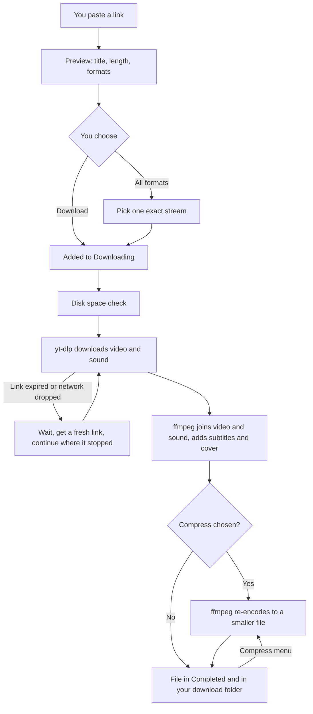

# How MediaHarvest works

This page explains, in plain words, what happens between pasting a link and
getting a file, and which part of the code does each step. You don't need to
read code to follow it. The file names are there for anyone who wants to look.

## The parts

MediaHarvest is three programs working together inside one Docker container.

| Part | What it does | Where it lives |
|---|---|---|
| **The web page** | What you see in the browser: the link box, the options, the Downloading and Completed lists. | `ui/` (Angular) |
| **The server** | Takes requests from the page, keeps the download list, runs downloads and tells the page how they're going. | `app/` (Python) |
| **The tools** | [yt-dlp](https://github.com/yt-dlp/yt-dlp) reads the site and downloads the streams. [ffmpeg](https://ffmpeg.org) joins video and sound, converts formats and makes videos smaller. | Installed in the Docker image |

The page and the server talk over a live connection (Socket.IO), so a progress
bar moves without you reloading anything.

On Windows there is a fourth part, outside the container: a small helper
(`windows/MediaHarvest.ps1`) that the desktop shortcut runs. It starts Docker
Desktop and MediaHarvest, opens the page, then waits in the background. The
container cannot reach Windows, so when you press Close, Browse or Save and
restart in Settings, the server leaves a request in a shared folder and the
helper does it: stops everything, opens the Windows folder picker, or restarts
the container with the new folders. The helper writes a heartbeat every few
seconds; these buttons work only while it beats (`app/app_settings.py`,
`HostHelper`).

## From link to file

### 1. Paste a link

The page sends the link to the server, which asks yt-dlp what it is without
downloading anything: the title, the length, the thumbnail and how many formats
the site offers. That's the preview card.

*Code:* `app/format_probe.py` (the preview and the All formats list),
`ui/src/app/components/format-picker.component.ts` (the picker window).

### 2. Choose

You pick a type (Video, Audio, Captions or Thumbnail) and its options: quality,
format, subtitles, and for video, Compress. The choices offered come from one
list on the server, so the page and the server always agree on what's allowed.
Your last choices are remembered in the browser.

*Code:* `app/format_catalog.py` (every option and its label),
`app/dl_formats.py` (turns your choices into yt-dlp settings).

### 3. Download

The download goes into a queue. Three run at once by default; the rest wait.
Each one runs in its own process, so one stuck download can't freeze the
others or the page.

Before it starts, the server checks the drive has room for the file, plus the
extra room ffmpeg needs while it joins video and sound (about twice the final
size).

*Code:* `app/ytdl.py` (the queue and each download),
`app/media_extras.py` (the disk check, lyrics, smaller audio, compression).

### 4. When a download stops, it carries on

Long downloads often stop part-way. YouTube's download links expire after about
six hours, and networks drop. MediaHarvest treats that as a pause: it waits,
asks the site for a fresh link and continues from the partial file, so nothing
already downloaded is fetched again. The waits grow from 15 seconds to
5 minutes. After 10 tries in a row with no progress the download shows as
failed, and **Retry** still continues from the partial file.

A restart of the computer or the container does the same: unfinished downloads
pick up where they were.

*Code:* `app/ytdl.py` (`_resume_delay` and the resume loop in `Download`).

### 5. Join and finish

yt-dlp downloads the picture and the sound as separate streams. ffmpeg puts them
in one file and adds subtitles, chapters, the cover image and tags.

### 6. Make it smaller (optional)

If you chose a Compress level, ffmpeg re-encodes the picture: as AV1, a newer
format that needs fewer bytes for the same picture, or as H.264 for Any
device. The section below has the details.

### 7. Completed

The finished file appears under **Completed** and in your download folder. Click
its name to save it to the device you're using. The list is kept on disk, so it
survives restarts.

*Code:* `app/state_store.py` (saves the lists),
`ui/src/app/components/completed-section.component.*` (the Completed list).

## Making videos smaller

### What it does

Sites already compress their videos, but with formats chosen for fast streaming
to every kind of device. Re-encoding at a level you pick keeps the picture
close to the original in far fewer bytes.

Everything used is open source with no limits: **ffmpeg** runs the job,
**SVT-AV1** or **H.264** encodes the picture and **Opus** or **AAC** encodes
the sound. These are the same encoders the HandBrake app uses, already inside
MediaHarvest's image, so there's nothing extra to install.

### The levels

| Level | Picture | Sound | Size on the test video | Picture score (VMAF) |
|---|---|---|---|---|
| **Light** | AV1, same resolution | kept as it is | 24% smaller | 93.5 |
| **Medium** | AV1, same resolution | Opus 64 kbps | 51% smaller | 91.8 |
| **Strong** | AV1, at most 480p | Opus 48 kbps | 64% smaller | 82.8 |
| **Any device** | H.264 in an MP4 | AAC 96 kbps | 20% smaller | 90 to 92 |

**VMAF** is a 0 to 100 score of how close a re-encoded picture looks to the
original, made by Netflix. Above about 93 most people can't tell the two apart.
Around 90 a careful viewer can see some softness in fine detail.

**AV1 or H.264?** AV1 gives the smallest files and plays in current browsers,
VLC, Windows 11, Android, and newer iPhones and Macs. Some older TVs, phones
and car screens can't play it. H.264 plays on everything made in the last 15
years, but needs more bytes for the same picture, so Any device saves less.

**Resolution** limits any level to 1080p, 720p, 480p or 360p. Strong already
stops at 480p; with a lower limit, the lower one wins. A video is never made
larger than it is.

The test video was a 138-hour 720p YouTube recording (51.3 GB, VP9 picture and
Opus sound). The figures come from clips taken evenly across its length. On the
whole file that would be about 39 GB (Light), 25 GB (Medium) or 18.5 GB
(Strong).

Tests inside the app:
- A 10-minute 720p film downloaded with Medium: 97.5 MB → 58.8 MB (40% smaller).
- A 3.5-minute music video with Any device at 480p: an MKV of 21.0 MB became an
  MP4 of 20.0 MB (5% smaller). The picture went from 720p to 480p, and the
  English subtitle track came through. This one shrank little because its
  720p picture was already small for its length.

### Using the graphics card

**Any device** uses an NVIDIA graphics card (NVENC) when the computer has one
and Docker can reach it; the installer sets this up when it finds one. On the
test clips it was about twice as fast as the processor, at a slightly lower
VMAF (90 against 92) for the same size. Without a card, the processor does it.

The AV1 levels always run on the processor. Graphics cards before NVIDIA's RTX
40 series can't encode AV1, and on the test video the processor was faster
anyway: reading YouTube's VP9 picture, which happens for every level, already
limits a card to about 16 times real time.

### How to use it

- **While downloading:** pick a level in **Compress** (and a **Resolution** if
  you want) before pressing Download. After the download, the row shows
  *Compressing* with a percentage, then moves to Completed with a line such as
  "Compressed (Medium): 97.50 MB → 58.82 MB, 40% smaller".
- **Later:** in Completed, press the compress button on a video's row, choose a
  Resolution at the top of the menu if you like, and pick a level.
- **From the command line:** see
  [CONFIGURATION.md](CONFIGURATION.md#compressing-videos).

### What to expect

- **Time:** the AV1 levels run at 14 to 17 times real time on a 12-core
  computer, so an hour of video takes about 4 minutes. A very long video takes
  hours: the 138-hour test video would take 8 to 10. For something that long,
  downloading a lower Quality in the first place is quicker.
- **Only when it helps:** if the new file isn't at least 5% smaller, the
  original is kept and the row says so. This happens with videos the site
  already compressed hard.
- **Safe:** the smaller file is written beside the original as
  `name.compressing.ext` and only replaces it once it's complete. If anything
  goes wrong, the original stays as it was. If the computer or container
  restarts in the middle, the half-written file is removed at the next start.
- **Room needed:** up to the video's own size free on the same drive while it
  runs.

### What happens to subtitles, sound tracks and covers

Every stream in the file is handled on its own:

| In the file | Light, Medium, Strong | Any device |
|---|---|---|
| Picture | re-encoded as AV1 | re-encoded as H.264 |
| Every sound track (for example two languages) | kept (Light) or re-encoded (Medium, Strong) | re-encoded as AAC |
| Subtitle tracks | copied as they are | turned into MP4 subtitles |
| Chapters, title, artist and other tags | copied | copied |
| Cover picture | copied | kept when it's a JPEG or PNG |
| Fonts attached to an MKV, picture-based subtitles | copied | left out (an MP4 can't hold them) |

The `.srt` subtitle files saved beside the video aren't touched.

*Code:* `app/compress.py` (the levels, the per-stream ffmpeg command, GPU
detection, progress, the keep-or-replace rule), `CompressPP` in
`app/media_extras.py` (compress right after a download),
`DownloadQueue.compress` in `app/ytdl.py` (the Completed menu).

## Where things are saved

| What | Where |
|---|---|
| Your files | The download folder (`Downloads/MediaHarvest` with the installer) |
| The Downloading and Completed lists, subscriptions | `.metube` inside the download folder; with the Windows shortcut, `%LOCALAPPDATA%\MediaHarvest\state`, so they stay when you change the download folder |
| The Settings page's choices | `settings.json` beside those lists (`app/app_settings.py`) |
| The folders (Windows) | `%LOCALAPPDATA%\MediaHarvest\helper-config.json`, kept by the helper |
| Everything else | Environment variables, see [CONFIGURATION.md](CONFIGURATION.md) |

## Checking the code works

There are about 1,230 automatic tests: 1,057 for the server and 174 for the
page. They run in Docker, and on GitHub for every change. See
[CONTRIBUTING.md](../CONTRIBUTING.md).
